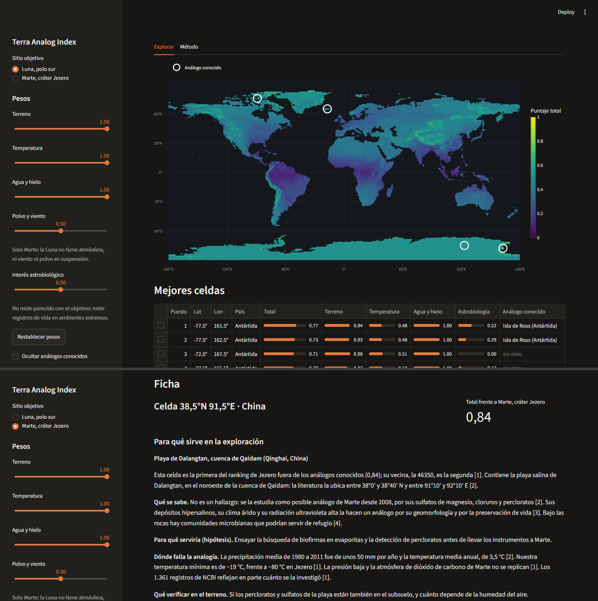

# Terra Analog Index

Which places on Earth look most like the lunar south pole or Jezero crater on Mars? Terra Analog Index
splits Earth's land into 1° cells (about 110 km), measures each one on terrain, temperature, water and
ice, and (for Mars) dust and wind, and scores how close it comes to each target. You choose how much each dimension weighs and
the app ranks the best Earth analogs, explaining where each one matches the target and where the
analogy breaks down. A last dimension, astrobiological interest, counts records of extremophile life
in NCBI BioSample.

Built for NASA Space Apps Challenge 2026.

**Live app:** <https://terra-analog-index.onrender.com> (hosted on Render's free plan: after about 15 minutes without visits it
goes to sleep and the next visit takes up to a minute to load; every push to `develop` redeploys it)



## Run the app

You need Python 3.11 or newer, `make` and `git`. The processed data (1.8 MB) is in the repository, so
the app runs without downloading anything.

```bash
git clone https://github.com/NASA-spaceapps-sigsegv/terra-analog-index.git
cd terra-analog-index
make install-app   # creates .venv and installs the app's dependencies
make app           # opens http://localhost:8501
```

`make app-demo` runs the app on the small hand-made test data in `tests/fixtures/` instead.

The app's interface is in Spanish. In the sidebar you pick the target (*Sitio objetivo*) and the
weights; the map colors every cell by its total score; selecting a row of the ranking (*Mejores
celdas*) opens that cell's card (*Ficha*), with a radar of its dimensions, Earth against target for
each variable, the sources, and the limits that no place on Earth can replicate. *Descargar CSV*, under
the ranking, saves the table as it is shown (same rows and columns). *Mostrar cuevas y tubos de lava*,
off by default, adds known caves and lava tubes studied as Moon and Mars analogs to the map, with
the reason and the source on hover. It is informative only and changes no score.

The *Método* tab shows how the numbers are made: what the tool does, the variables of each target with
their sources, the data and its licenses, the scoring rules, the validation table (every known analog
with its percentile and `pass`, `fail` or `info`), the limits and the credits. Its text is in
`content/method.md`; every figure and table comes from `data/processed/`.

**Windows:** run `make` from Git Bash or WSL. Without `make`, the same commands are in the
`Makefile`: `python -m venv .venv`, `.venv\Scripts\python -m pip install -r requirements.txt`,
`.venv\Scripts\python -m streamlit run streamlit_app.py`.

`make help` lists every command.

## Deployment

The live app runs on [Render](https://render.com) as a free web service, built from the `develop` branch; every push to
`develop` redeploys it. The settings are:

| Setting | Value |
| --- | --- |
| Repository and branch | this repository, `develop` |
| Language | Python 3 (Render's default, 3.14 at the time of writing; tested locally on 3.13) |
| Build command | `pip install -r requirements.txt` |
| Start command | `streamlit run streamlit_app.py --server.port $PORT --server.address 0.0.0.0 --server.headless true` |
| Instance type | Free |

The app only reads `data/processed/` and `requirements.txt` holds just the runtime packages, so no environment variables or
secrets are needed. On the free plan the instance goes to sleep after about 15 minutes without visits, so the next visit can
take a minute to load, and each interaction takes 3 to 4 seconds (0.3 seconds when run locally). For a demo, open the link a few
minutes before or run the app locally with `make app`.

## Regenerate the data, step by step

The app only reads `data/processed/`. Everything in it comes from an offline pipeline of nine steps
that runs on a laptop. A full run downloads about 5.9 GB.

**1. Accounts and credentials.** Put them in a `.env` file at the repository root (it is git-ignored;
one `NAME=value` per line, no quotes). The `Makefile` loads it.

| Variable | Needed by | How to get it |
| --- | --- | --- |
| `EARTHDATA_USERNAME`, `EARTHDATA_PASSWORD` | MODIS and IMERG downloads (steps 03 and 04) | Free [NASA Earthdata Login](https://urs.earthdata.nasa.gov/). For IMERG, also authorize *NASA GESDISC DATA ARCHIVE* under *Applications → Authorized Apps*. A `~/.netrc` entry for `urs.earthdata.nasa.gov` works too. |
| `NCBI_EMAIL` | NCBI BioSample queries (step 05) | Any email you read; NCBI asks for it. |
| `NCBI_API_KEY` (optional) | Step 05 | [NCBI account settings](https://www.ncbi.nlm.nih.gov/account/settings/); allows 10 requests per second instead of 3. |

**2. Install everything** (pipeline, tests and app). On Windows, if `rasterio` or `geopandas` fail to
install with pip, install them with conda.

```bash
make install
```

**3. Download the raw data** into `data/raw/` (not versioned). Files already on disk are skipped and an
interrupted download resumes. `data/raw/README.md` documents every product, version and decision.

```bash
make data
```

**4. Run the pipeline.** Steps run in order and the run stops at the first failure. A step whose outputs
are newer than its inputs and its code reports *al día* and does nothing; `FORCE=1` reruns it anyway.
Because freshness is based on file times, a `git checkout` that touches a step's code makes that step
and everything after it run again.

```bash
make pipeline            # all steps
make step-08 FORCE=1     # one step
make pipeline BBOX="-30 -20 -75 -65"   # quick test on a region (lat min, lat max, lon min, lon max)
```

| Step | Reads | Writes |
| --- | --- | --- |
| `01_grid` | Natural Earth land and countries | `data/processed/grid.parquet`, land mask |
| `02_terrain` | ETOPO 2022 elevation | slope and roughness per cell |
| `03_temperature` | MODIS MOD11C3 monthly land surface temperature | minimum temperature and daily range per cell |
| `04_dust_wind` | MERRA-2 monthly dust optical depth and surface wind speed | dust and wind per cell |
| `04_water_ice` | GPM IMERG precipitation, MODIS MOD10CM snow cover, MCD12C1 land cover | precipitation and snow/ice fraction per cell |
| `05_biology_ncbi` | NCBI BioSample (network) | `data/processed/bio_samples.parquet`, records per cell |
| `06_features` | steps 02 to 05 | `data/processed/features.parquet` and Earth statistics |
| `07_targets` | `config/targets_base.json`, LOLA and MOLA elevation | `data/processed/targets.json` |
| `08_similarity` | features, targets, `config/known_analogs.csv`, `config/caves.csv` | `data/processed/similarity.parquet`, `known_analogs.csv`, `caves.csv` |
| `09_validation` | similarity and known analogs | `data/processed/validation.json` |

Every step records its inputs, outputs and timing in `data/processed/manifest.json`.

**5. Check the result.**

```bash
make maps         # control maps of steps 01 to 04 in data/interim/maps/
make check-data   # every processed file loads, matches its contract and stays under 50 MB
```

## How scoring works

Each variable gets a score from 0 to 1 for each target. When the target's value is within Earth's range
(slope, roughness), the score measures overlap with the target's distribution. When the target is beyond
anything on Earth (−223 °C at the lunar south pole), the score says how extreme the cell is among Earth's
land: 0.95 means "colder than 95% of the land area", not "95% like the Moon". Ice scores presence or
absence, depending on whether the target has surface ice. A dimension is the mean of its variables, and
the total is the weighted mean of the dimensions that have data. A cell needs data in at least two of
the three core physical dimensions (terrain, temperature, water and ice) to be ranked.

Dust and wind applies only to Mars: the Moon has no atmosphere, so its total leaves that dimension out.
Jezero's dust optical depth (about 0.45) is beyond almost all of Earth, so dustier cells score higher;
its daytime wind (about 4 m/s) is within Earth's range, so the score measures closeness.

To validate the method, the known analogs in `config/known_analogs.csv` (field sites that research
teams already use) should land in the top 10% of their target's ranking. The results, including the
ones that fail and why, are in `data/processed/validation.json` and in the app's *Método* tab.

## Data and credits

| Data | Used for | Source | Terms |
| --- | --- | --- | --- |
| Natural Earth 1:50m land and countries | Grid, country names | [naturalearthdata.com](https://www.naturalearthdata.com/) | Public domain |
| ETOPO 2022, 30 arc-second surface elevation | Earth slope and roughness | [NOAA NCEI](https://www.ncei.noaa.gov/products/etopo-global-relief-model) | Public domain (U.S. Government) |
| MODIS/Terra MOD11C3 v061, 2024 | Earth surface temperature | [LP DAAC, doi:10.5067/MODIS/MOD11C3.061](https://doi.org/10.5067/MODIS/MOD11C3.061) | NASA open data |
| GPM IMERG Final monthly V07, 2024 | Earth precipitation | [GES DISC](https://disc.gsfc.nasa.gov/datasets/GPM_3IMERGM_07/summary) | NASA open data |
| MODIS/Terra MOD10CM v061, 2024 | Earth snow cover | [NSIDC, doi:10.5067/MODIS/MOD10CM.061](https://doi.org/10.5067/MODIS/MOD10CM.061) | NASA open data |
| MODIS MCD12C1 v061, 2024 | Permanent snow and ice | [LP DAAC, doi:10.5067/MODIS/MCD12C1.061](https://doi.org/10.5067/MODIS/MCD12C1.061) | NASA open data |
| MERRA-2 M2TMNXAER v5.12.4, 2024 | Earth dust optical depth | [GES DISC, doi:10.5067/FH9A0MLJPC7N](https://doi.org/10.5067/FH9A0MLJPC7N) | NASA open data |
| MERRA-2 M2TMNXFLX v5.12.4, 2024 | Earth surface wind speed | [GES DISC, doi:10.5067/0JRLVL8YV2Y4](https://doi.org/10.5067/0JRLVL8YV2Y4) | NASA open data |
| NCBI BioSample | Extremophile records | [NCBI](https://www.ncbi.nlm.nih.gov/biosample) | Public NCBI data ([policies](https://www.ncbi.nlm.nih.gov/home/about/policies/)) |
| LOLA LDEM_80S_80MPP_ADJ (LRO) | Lunar south pole terrain | [NASA PGDA](https://pgda.gsfc.nasa.gov/products/90) | NASA open data |
| MOLA global mosaic, 463 m (MGS) | Jezero terrain | [USGS Astrogeology](https://planetarymaps.usgs.gov/mosaic/Mars_MGS_MOLA_DEM_mosaic_global_463m.tif) | Public domain (U.S. Government) |

Target values that cannot be measured from a map come from the literature:

- Lunar south pole temperatures: Williams, J.-P. et al. (2017). The global surface temperatures of the Moon as measured by the Diviner Lunar Radiometer Experiment. *Icarus* 283, 300–325. doi:10.1016/j.icarus.2016.08.012
- Lunar surface ice: Li, S. et al. (2018). Direct evidence of surface exposed water ice in the lunar polar regions. *PNAS* 115(36), 8907–8912. doi:10.1073/pnas.1802345115
- Jezero temperatures (MEDA, Perseverance): Savijärvi, H. et al. (2023), *JGR Planets*, doi:10.1029/2022JE007438; Atri, D. et al. (2022), *MNRAS*, arXiv:2204.12850
- Jezero dust: Rodriguez-Manfredi, J. A. et al. (2023). The diverse meteorology of Jezero crater over the first 250 sols of Perseverance on Mars. *Nature Geoscience* 16, 19–28. doi:10.1038/s41561-022-01084-0; Lemmon, M. T. et al. (2022), *Geophysical Research Letters*, doi:10.1029/2022GL100126
- Jezero wind: Newman, C. E. et al. (2022). The dynamic atmospheric and aeolian environment of Jezero crater, Mars. *Science Advances* 8, eabn3783. doi:10.1126/sciadv.abn3783
- Ice on Mars: Morgan, G. A. et al. (2021). Availability of subsurface water-ice resources in the northern mid-latitudes of Mars. *Nature Astronomy* 5, 230–236

Each known analog cites its source in `config/known_analogs.csv`, and each cave or lava tube in
`config/caves.csv` (among them NASA BRAILLE, NASA SSERVI FINESSE, ESA PANGAEA-X, CHILL-ICE and Sauro, F.
et al. (2020), Lava tubes on Earth, Moon and Mars, *Earth-Science Reviews* 209, 103288). The site card in the app cites the
source of every value it shows.

## Limitations

- **Directional scores do not measure distance to the target.** Earth never reaches lunar or Martian
  values; a high temperature score means "among the coldest on Earth", and the card always shows the
  target's real value next to it.
- **Biological sampling bias.** Astrobiological interest reflects where people have taken samples:
  famous sites score higher and unexplored ones score 0. It uses a logarithm, starts at half weight,
  and every card says that missing records may mean nobody sampled there.
- **Cells of about 110 km.** A crater, a salt flat or a cave is averaged out within its cell; that is why
  caves and lava tubes are shown as points on the map, without a score.
- **Missing dimensions.** Geology and mineralogy, subsurface and rover operations are out of scope.
- **Dust and wind on Earth come from a reanalysis** (MERRA-2, a model), not an observation, and Earth's
  wind is at about 10 m while Perseverance measures it at 1.5 m.
- **One year of data** (2024), and **surface temperature**, not air temperature.
- **The lunar day lasts about 29.5 Earth days**, so the lunar "daily range" is the range over a lunar
  cycle.
- **What no place on Earth replicates:** gravity (1.62 m/s² on the Moon, 3.71 m/s² on Mars), vacuum or a
  thin CO₂ atmosphere, unshielded radiation, abrasive charged regolith, perchlorates and global dust
  storms. Every card lists the ones that apply to its target.

## Future work

- Refine the finalist areas to 0.5° cells.
- More targets beyond the lunar south pole and Jezero.

## Development

| Folder | Contents |
| --- | --- |
| `tai/` | Shared core: constants, grid geometry, contract models, scoring rules, site cards, *Método* tables. No Streamlit, no network, no file writes |
| `pipeline/` | Steps `01_grid.py` to `09_validation.py` and shared utilities in `common.py` |
| `ui/` | Streamlit views: sidebar, map, ranking, site card, *Método* tab |
| `config/` | Hand-edited inputs: target profiles, known analogs, caves and lava tubes, NCBI search terms |
| `content/cards/` | Hand-written text for finalist cards, `<cell_id>__<target_id>.md` |
| `content/method.md` | Fixed text of the *Método* tab, one `## ` heading per section |
| `data/raw/`, `data/interim/` | Downloads and intermediate files (not versioned; see `data/raw/README.md`) |
| `data/processed/` | What the app reads (versioned) |
| `docs/` | End-to-end test report, sources log and the screenshot and logo used here |
| `scripts/` | Control maps, card and secret checks |
| `tests/` | pytest; `tests/fixtures/` has one small file per contract |

```bash
make test       # all tests
make cards      # check the hand-written card texts and say what each one is missing
make check      # tests, cards, processed data and a secret scan of files and history
make fixtures   # regenerate the test fixtures
make clean      # Python and pytest caches, control maps
```

Run `make check` before merging into `main`. Work happens on one branch per ticket (`tai-12-terrain`),
created from `develop` and merged back with the tests passing. Commits follow
[Conventional Commits](https://www.conventionalcommits.org/).

## Team

- **Juanma**: repository and grid, terrain, temperature, water and ice, known analogs, similarity, ranking, site card, caves and lava tubes layer, deployment
- **Alan**: NCBI layer, target profiles, scoring, validation, map, *Método* tab
- **Santino**: scientific criteria, data sources, target values, NCBI search terms, method text, card texts, pitch
- **Santiago**: app skeleton, control maps, README, video

## License

The code is licensed under the [GNU GPL v3](LICENSE). The data keep their own terms (see
[Data and credits](#data-and-credits)).

**Use of AI.** The team used Claude Code (Anthropic) as a coding assistant; commits it helped write
carry a `Co-Authored-By` line.
